  

  

  Hi, I'm <b>Lowzii</b> — a developer based in <b>Da Nang, Vietnam</b>. 
  I build automation, practical software tools and the systems that keep online communities running. 
  I also founded and run <b>MeTech</b>, a technology community of <b>3,000+ members</b>.

  
  
  

 

<h2 align="center">What I build</h2>

<table>
  <tr>
    <td width="33%" align="center" valign="top">
       
      
      
Workflows that run on their own, stay reliable and recover cleanly when something goes wrong.

    </td>
    <td width="33%" align="center" valign="top">
       
      
      
Focused, practical tools — Java and TypeScript for apps and services, C++ for native components.

    </td>
    <td width="33%" align="center" valign="top">
       
      
      
Discord systems behind MeTech — tickets, support and member management at community scale.

    </td>
  </tr>
</table>

 

  

 

<h2 align="center">MeTech</h2>

  <b>Useful tools. Reliable systems.</b> 
  A technology community of 3,000+ members — join us on Discord to follow new projects and talk tech.

  
  &nbsp;
  

 

  

